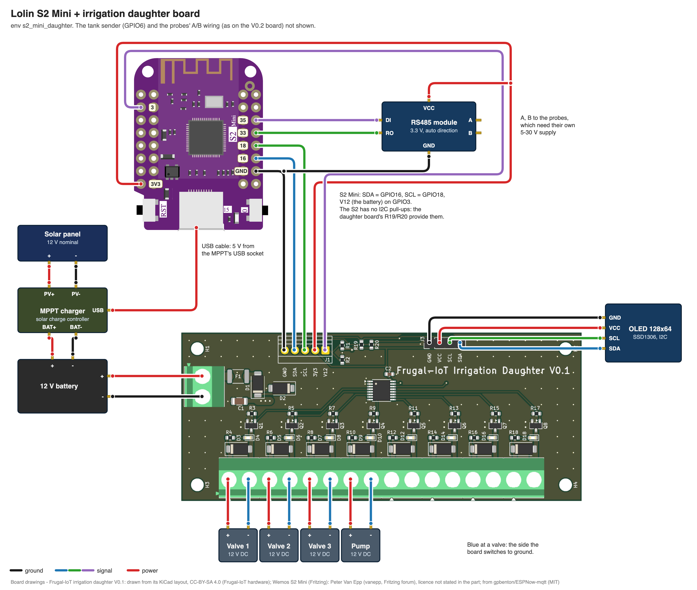
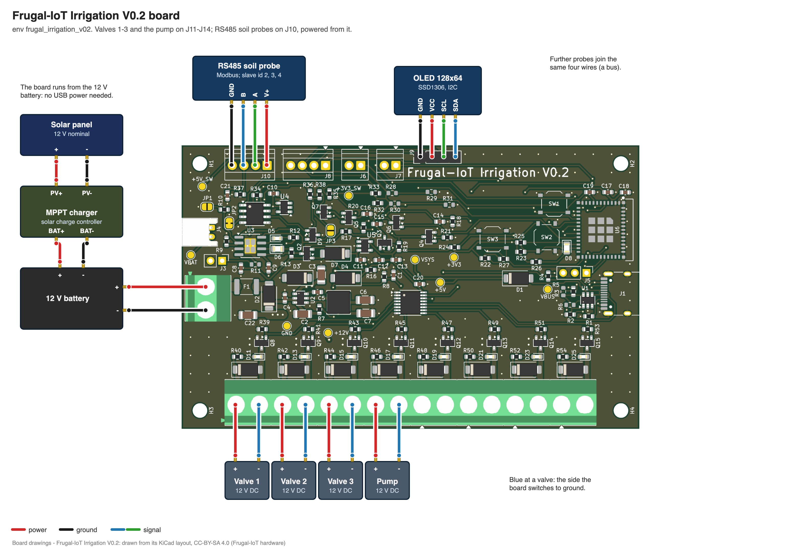
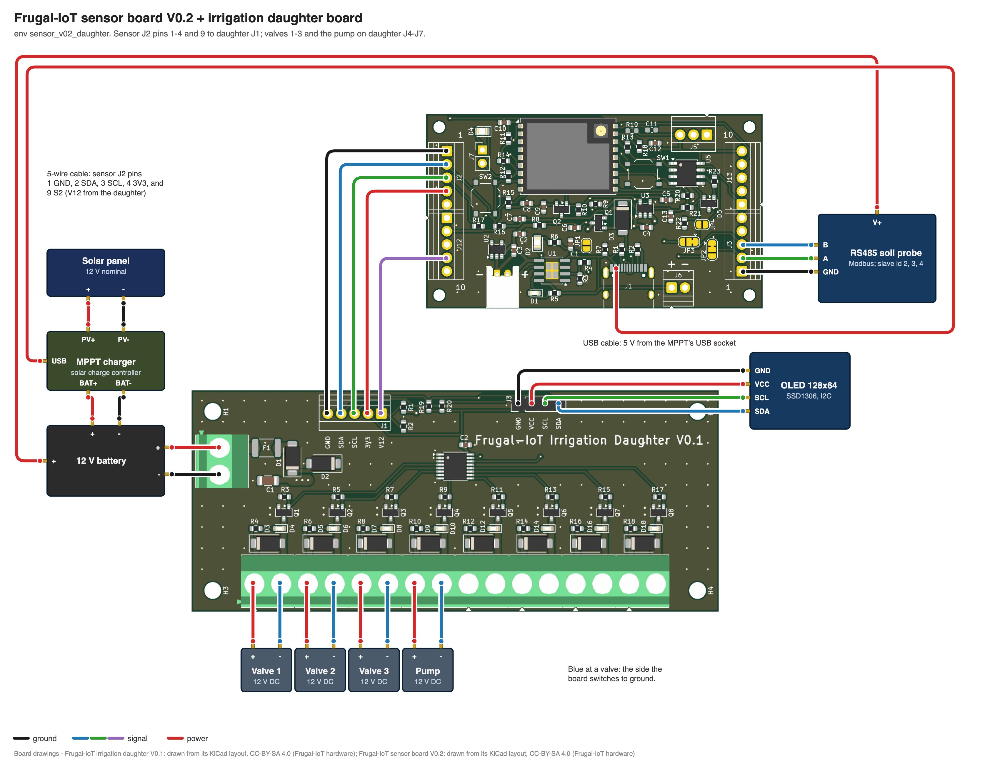

# Frugal-IoT Irrigation

This project is intended to provide solar-powered irrigation for small farms. A set of sectors is watered one at a time, once a day. 

The default version waters each sector until its soil reaches a target moisture or a time limit runs out, but it can be 
subclased for more complex per-sector requirements. 

There are tank-level and battery interlocks that stop the whole run, and this also can be customized. 

It is built on top of Frugal-IoT and both the irrigation and MPPT components draw part of their
inspiration from [OSPIT](https://www.apc.org/en/news/meet-ospit-sustainable-energy-and-irrigation-solution-community-networks)
(Lua on the FF-ESP32-OpenMPPT solar charge controller)
- [OSPIT_COMPARISON.md](OSPIT_COMPARISON.md) describes what is different and why.

This release should work in several hardware environments.

* The "FF-ESP32-OpenMPPT solar charge controller" in which case it will run MPPT 
* Our custom boards in `hardware`: an all-in-one irrigation board, or a valve daughter board for the Frugal-IoT sensor board or a plain S2 Mini. 
* A simple off the shelf dev board with hardwired sensors, just edit board definitions in 
  platformio.ini and `wiring` in frugal-iot-irrigation.ino
* A distributed sensor environment, just change the `wiring` in frugal-iot-irrigation.ino 
  to point at the distributed sensors

[Frugal-IoT](https://github.com/mitra42/frugal-iot) brings: WiFi setup from a phone; MQTT; web and phone dashboards; graphing and over-the-air updates.  

Any of the other features of Frugal-IoT can be easily added to your sketch including, off-internet operation, remote sensors, LoRa, or a wide range of other sensors for example for weather. 

## What it does today

- **Up to N irrigation sectors**, run strictly in order, one valve open at a time.
- **Soil moisture per sector** from RS485/Modbus probes sharing one bus, or from simple
  analog capacitive soil sensors.
- Anomaly handling - for instance, a sector whose probe is **not reporting is skipped**
- **Tank level** from a float sender, with two thresholds: one to begin a run, a lower one to
  abort it. "No tank sensor fitted" is kept distinct from "tank empty".
- **Battery interlock** - irrigation stops below a configurable voltage and resumes above a higher
  one.
- Optional **pump** (driven with the valves) and **load output** (e.g. for a router) (switched by the
  battery interlock) on separate pins.
- Optional **OLED**: Displays battery; sector moistures; tank and communicationss status.
- **Solar charge control** - two-stage MPPT tracking with temperature compensation, a hard
  thermal cut-out, and battery-type profiles.
- **Battery reporting** - state of charge and a health estimate inferred from voltage drop.

## Status

**None of the charge control has run on real hardware yet**, so it ships switched off. 

Run the checks in [TESTING.md](TESTING.md) and then turn on `mppt/automatic`

`HARDWARE-QUESTIONS.md` is a list of things we need someone with the OSPIT hardware to
look at and confirm.

## Hardware

Five boards are supported out of the box. See `platformio.ini` for the full pin list, and the wiring
diagrams below for the three you wire up yourself.

| Board | env | Notes |
|---|---|---|
| **FF-ESP32-OpenMPPT** | `ff_openmppt` | the solar charge controller OSPIT runs on. Pin assignments are OSPIT's own |
| **Lolin S2 Mini + irrigation daughter board** | `s2_mini_daughter` | a plain dev board driving `hardware/irrigation-daughter` over I2C |
| **Frugal-IoT Irrigation V0.2** | `frugal_irrigation_v02` | `hardware/irrigation-layout-oct-2026`: eight MOSFET valve outputs, RS485, 12 V buck, LiPo charging, all on one board |
| **Frugal-IoT sensor board V0.2 + irrigation daughter board** | `sensor_v02_daughter` | the [sensor board](https://github.com/mitra42/frugal-iot-hw-sensor) driving the daughter board |
| **Lolin S2 Mini** | `s2_mini` | valves straight from GPIOs, through a driver of your own; no charging hardware |
| other | | Setting up support for most other boards is trivial, look in the [Frugal-IoT/examples/all](https://github.com/mitra42/frugal-iot/blob/main/examples/all/platformio.ini) for example configuration for many popular boards or [add a new issue](https://github.com/mitra42/frugal-iot-irrigation/issues/new) in this repo. |

The **irrigation daughter board** (`hardware/irrigation-daughter`) is the irrigation board's eight valve drivers
on their own: a TCA9534 I2C expander, a MOSFET, flyback diode and LED per valve, a fused and protected 12 V
input, a header for the OLED, and a 12 V battery reading for the host. Paired with the sensor board it costs
about the same as the all-in-one V0.2 board, and the expensive half is a board made in larger numbers. Its host
is powered from 5 V USB - most MPPT charge controllers have a USB port - and its valves from the 12 V battery.

The `FF-ESP32-OpenMPTT` board has the needed functionality, but is going to be a significantly more expensive
solution than the Frugal-IoT boards paired, if neccessary, with an off-the-shelf MPPT controller.

You will also need: 12 V DC valves (not latching, not 24 V AC), one Modbus soil probe per sector, and
optionally a tank float sender and a pump.

The hardware in `hardware` is available as a full set of Gerber and fabrication files, designed for JLCPCB
but could be adapted to any manufacturer (and we would be happy to add files for other manufacturers). Note this
hardware has (as of Nov 2026) yet to be built and tested.

### Sectors and the pump

Every env runs **three sectors and a pump**: valves 1-3 and the pump on the first four outputs. A board with
more outputs - all three below have eight - can run up to seven sectors: uncomment `IRRIGATION_VALVE4_BIT`
(and 5, 6, 7) in its env. Each line adds a valve, a soil probe at the next Modbus slave id (5, 6, ...) and a
sector; the `.ino` picks them up by `#ifdef`. The OLED's soil page shows sectors 1-3 only.

### Wiring

Colours: red power, black ground, green, blue and purple signals. At a valve, blue is the side the board switches
to ground; valves are not polarised, so either lead will do. Each diagram shows the whole system: a solar panel
into an MPPT charge controller, the controller charging the 12 V battery, and the battery feeding the board's
12 V terminal.

**Lolin S2 Mini + daughter board** (`s2_mini_daughter`). The S2 Mini runs from the charge controller's USB
socket. To the daughter board's J1: GND, SDA (GPIO16), SCL (GPIO18), 3V3, and the battery reading V12 to GPIO3.
The daughter board's logic runs from the S2's 3V3, so it is always on. An RS485 module for the soil probes on
GPIO33 (RX, from the module's RO) and GPIO35 (TX, to its DI). It must run from **3.3 V** and switch direction
by itself: a module powered from 5 V puts 5 V on RO, which the S2 cannot take. The I2C pins are 16/18 rather
than the S2's usual 33/35 so that none of these wires cross. The S2 Mini has no I2C pull-ups; the daughter board's
4.7k pull-ups (R19/R20) are fitted for that reason.



**Frugal-IoT Irrigation V0.2** (`frugal_irrigation_v02`). Everything is on the board: valves and pump on
J11-J14, RS485 probes on J10 (which also powers them, from switched 5 V), OLED on J9. The board runs from the 12 V
battery on J2 (its own 5 V converter), so it needs no USB except for programming.



**Frugal-IoT sensor board V0.2 + daughter board** (`sensor_v02_daughter`). The sensor board runs from the charge
controller's USB socket, into its USB-C. A 5-wire cable from its J2 to the daughter board's J1, which reads GND,
SDA, SCL, 3V3, V12 left to right - the sensor board's J2 pins 1, 2, 3, 4 and 9 top to bottom, so the cable runs
straight. The daughter board's logic runs from the sensor board's switched 3.3 V rail: when it is off, every valve
is off. RS485 probes go on the sensor board's J3 (A, B, GND), and take their supply from the 12 V battery - the
sensor board has only 3.3 V there.



The diagrams are generated by `docs/wiring.py`; the three Frugal-IoT boards are KiCad's 3D renders of their
layouts, so they look as assembled and the labels are exactly what is printed on them. The S2 Mini drawing is Peter Van Epp's Fritzing part.

## Building

### PlatformIO (recommended)

```bash
pio run --environment ff_openmppt          # compile
pio run --target upload -e ff_openmppt     # flash
pio run --target uploadfs -e ff_openmppt   # upload data/ (WiFi passwords etc)
pio device monitor -e ff_openmppt          # watch it start
```

The Frugal-IoT library is fetched automatically, so a fresh clone needs nothing set up. 
If you are changing the library at the same time, 
see "Building against a local library" in [CLAUDE.md](CLAUDE.md).

### Arduino IDE

1. **Tools > Manage Libraries**, install **Frugal-IoT**, and choose **Install All** when it asks about dependencies.
2. **Tools > Board > Boards Manager**, and install **esp32** by Espressif Systems.
3. Open `frugal-iot-irrigation.ino` - the whole repository folder is the sketch folder.
4. **Tools > Board**: the row for your hardware below. **Tools > Port**: your board.
5. **Sketch > Show Sketch Folder**, rename `min_spiffs.csv` to `partitions.csv`, and choose
   **Tools > Partition Scheme > No OTA (2MB APP/2MB SPIFFS)** - OTA still works, as `partitions.csv` sets the real layout.
6. **Upload** (→), then **Tools > Serial Monitor** at 115200 baud.

| Tools > Board | configuration |
| --- | --- |
| ESP32 Dev Module | `ff_openmppt` |
| LOLIN S2 Mini | `s2_mini` |
| LOLIN S2 Mini, plus a file `build_opt.h` beside the .ino containing `-DS2_MINI_DAUGHTER` | `s2_mini_daughter` |
| ESP32C3 Dev Module, with **USB CDC On Boot: Enabled** | `sensor_v02_daughter` |
| - | `frugal_irrigation_v02` - PlatformIO only, it uses its own board variant |

`platform.h` is generated from `platformio.ini`. If you change pins there, re-run
`scripts/generate_platform_h.bash`, or the two toolchains will disagree.

### Enrolment secret and debug messages

Optional files, made from the Frugal-IoT library's
[templates](https://github.com/mitra42/frugal-iot/tree/main/templates) - each says how. Never commit them.

* `platformio-secrets-local.ini`, or `platform-secrets-local.h` for Arduino IDE - the enrolment
  secret, so the node joins your organization without an administrator approving it.
* `platformio-local.ini` - debug flags and serial port.

More in [Getting Started](https://github.com/mitra42/frugal-iot/wiki/Getting-Started#next-steps).

## First run

1. Flash, then power up. The device makes its own WiFi network - connect a phone to it.
2. A setup page opens (or browse to `192.168.4.1`). Give it your WiFi name and password.
3. **Irrigation starts switched off.** Turn it on in the **Irrigation** section, and set
   the start time while you are there.

#### FF board testing
We don't have a FF board to try out, so would appreciate feedback. 

`TESTING.md` walks through commissioning a real board step by step, including calibrating the tank and the battery. `HARDWARE-QUESTIONS.md` is a list of things we need someone with the OSPIT hardware to look at.

Because not everyone has sun, a multimeter and a fortnight, `docs/` holds three ready-made plans —
[bench](docs/plan-bench.md), [sunny half-day](docs/plan-sunny-session.md),
[days of running](docs/plan-long-run.md) — each a short ordered list of which Parts of `TESTING.md`
to do. Question 9 of `HARDWARE-QUESTIONS.md` picks one. [docs/sleep-test.md](docs/sleep-test.md) is
the one test that needs its own build, on the `sleep-test` branch.

## Licence

Same as Frugal-IoT. The OSPIT algorithms parts of this are derived from are GPL-2.0-or-later,
Copyright (C) 2026 Corinna 'Elektra' Aichele.
